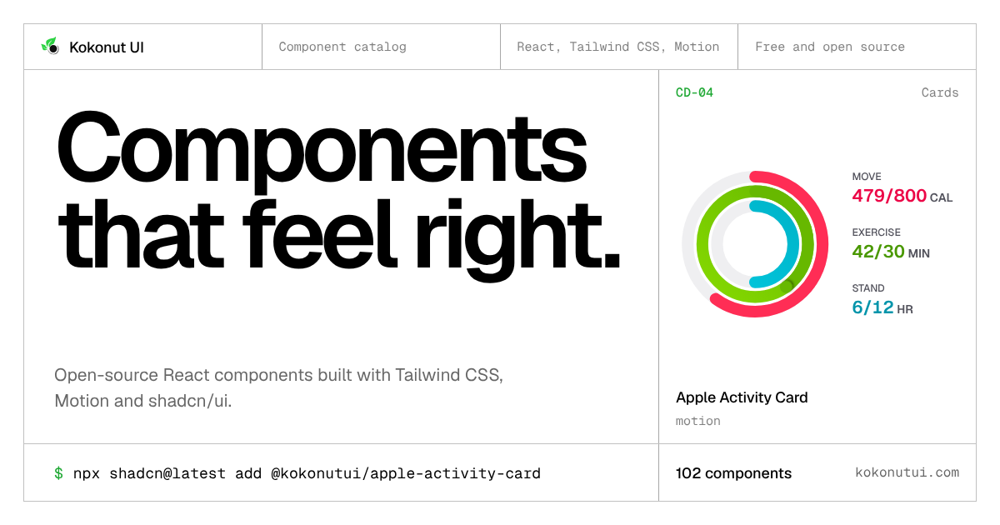

<p align="center">
  <a href="https://kokonutui.com">
    
  </a>
</p>

<h1 align="center">Kokonut UI</h1>

<p align="center">
  100+ open-source React components built with Tailwind CSS, Motion and shadcn/ui.<br>
  Install them with the shadcn CLI and they live in your codebase.
</p>

<p align="center">
  <a href="https://kokonutui.com/docs">Docs</a> ·
  <a href="https://kokonutui.com/docs/changelog">Changelog</a> ·
  <a href="https://kokonutui.com/docs/agents">Agents</a> ·
  <a href="https://kokonutui.pro">Pro</a>
</p>

## Quick start

Kokonut UI is a [shadcn/ui registry](https://ui.shadcn.com/docs/registry). Add the namespace to your `components.json`:

```json
{
  "registries": {
    "@kokonutui": "https://kokonutui.com/r/{name}.json"
  }
}
```

Then add any component by name:

```bash
npx shadcn@latest add @kokonutui/slide-to-confirm
```

```tsx
import SlideToConfirm from "@/components/kokonutui/slide-to-confirm";

export default function Page() {
  return <SlideToConfirm />;
}
```

The CLI writes the source to `components/kokonutui/` and installs its dependencies. You own the code from there. Full setup, including monorepos, is in the [installation guide](https://kokonutui.com/docs).

You can also install straight from this repo, with no `components.json` changes:

```bash
npx shadcn@latest add kokonut-labs/kokonutui/slide-to-confirm
```

## Components

| Category | Examples |
| --- | --- |
| [AI](https://kokonutui.com/docs/ai) | Tool Approval, Diff Review, Context Meter, Inline Citations, Model Selector, Voice |
| [Buttons](https://kokonutui.com/docs/buttons) | Slide to Confirm, Hold Button, Pay Button, Undo Button, Magnet Button |
| [Cards](https://kokonutui.com/docs/cards) | Apple Activity Card, Boarding Pass, Currency Transfer, Uptime Card, Receipt Printer |
| [Inputs](https://kokonutui.com/docs/inputs) | Seat Map, Wheel Picker, Signature Pad, Time Zone Planner, Amount Pad |
| [Navigation](https://kokonutui.com/docs/navigation) | Command Palette, Marking Menu, Smooth Drawer, Swipe Tabs, Status Island |
| [Media](https://kokonutui.com/docs/media) | Clip Trimmer, Synced Transcript, Photo Straighten, Focal Point Picker |
| [Text](https://kokonutui.com/docs/texts) | Split Flap Text, Spoiler Text, Typing Text, Marker Text |
| [Backgrounds](https://kokonutui.com/docs/backgrounds) | Dither Reveal Hero, Caustics, Halftone, Topo, Rain Glass |

Every component has a live demo, its source, and the packages it installs on its docs page. New ones land in the [changelog](https://kokonutui.com/docs/changelog).

## Use with AI agents

Claude Code, Cursor, VS Code and Codex can search and install Kokonut UI components through the [shadcn MCP server](https://ui.shadcn.com/docs/mcp). The [Agents page](https://kokonutui.com/docs/agents) has the one-line setup for each editor and a rules file to drop in. The docs are also available as plain text at [kokonutui.com/llms.txt](https://kokonutui.com/llms.txt).

## Kokonut UI Pro

[Kokonut UI Pro](https://kokonutui.pro) adds premium components, blocks and full Next.js [templates](https://kokonutui.com/docs/templates). Pro components install through the same shadcn CLI.

## Contributing

Issues and pull requests are welcome. To run the site locally:

```bash
git clone https://github.com/kokonut-labs/kokonutui.git
cd kokonutui
bun install
bun run dev
```

Components live in `components/kokonutui/`, their docs in `content/docs/<category>/`, and their registry entries in `registry/registry-components.ts`. Run `bun x ultracite fix` before committing. The registry JSON in `public/r/` is rebuilt by CI on merge, so you don't need to commit it.

## Sponsor

Thanks to [Vercel](https://vercel.com/oss) for sponsoring this project through the Vercel OSS Program.

<a href="https://vercel.com/oss">
  
</a>

## License

[MIT](LICENSE)
